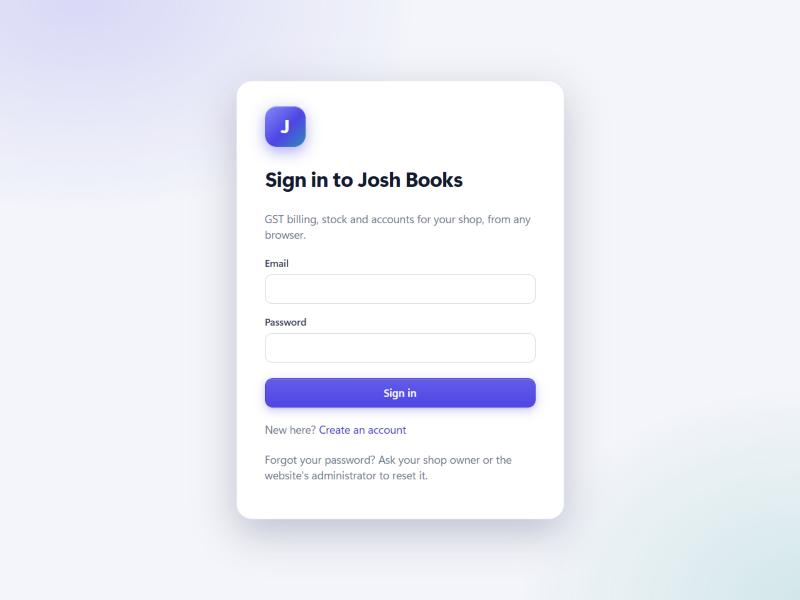
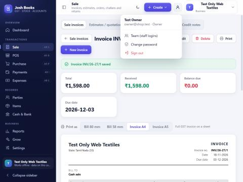
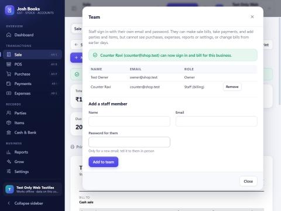
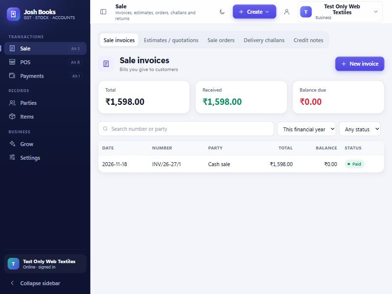

# Josh Books as a website

The whole app also runs in a web browser. People **sign up and sign in with email and password**, each account
sees only its own businesses, and an owner can give **staff** their own logins. The screens and the business rules
(GST, stock, ledger, numbering, printing) are exactly the desktop app's: the website runs the same code.



## What is the same, and what is different

| | Desktop app | Website |
|---|---|---|
| Bills, POS, items, parties, payments, stock, reports, GST returns, labels, posters | ✓ | ✓ the same screens |
| Who can use it | Anyone at the computer | Only people signed in with email and password |
| Staff | — | Owner adds staff under **Team**; staff get the desktop's staff limits |
| Printing | Straight to the printer | The browser's print window (also offers **Save as PDF**) |
| Bill PDF, labels PDF, catalogue, poster | Saved as files | The browser's print window → Save as PDF |
| Excel export, import template, GSTR-1 JSON, backup | Saved where you choose | Downloaded by the browser |
| Excel import, open a backup | File window | The browser's file chooser (uploads the file) |
| WhatsApp, Gmail, SMS sharing | Opens the link | Opens the link in a new tab (the bill PDF is not attached) |
| Copy poster to clipboard | ✓ | Not available: use Save |
| Backups | Daily on the computer, plus a second place | Daily on the server (kept 7 days), plus **Back up now** to download a copy |
| Data | On the computer | On the server |

The website and the desktop app keep **separate data**: there is no live sync. To move a shop online, use
**Settings › Backup & restore › Back up now** in the desktop app, then **Open a backup file…** on the website's start
page. To go back, download a backup from the website and open it in the desktop app the same way.

## Accounts, owners and staff

- **Sign up**: name, email, password (at least 8 characters, not easy to guess, not containing the email name).
- Whoever creates a business is its **owner**. One account can own several businesses and switch between them.
- **Team** (account button at the top right, owners only): add a staff member with their name, email and a password
  for them. If that email already has an account, they keep their own password and simply get access. **Remove** takes
  the access away at once.
- **Staff** see Sale, POS, Payments, Parties, Items, Grow and Settings. The server refuses everything else (purchases,
  expenses, cash and bank, reports, backups, business settings), staff cannot change bills or payments from earlier days,
  and staff payments are money in only. These are the same rules as the desktop's staff logins (`checkRole` in
  `src/main/access.ts`).
- **Change password** (account button): signs the person out on every other device.
- **Forgotten password**: there is no email sending yet, so the person who runs the server resets it (see below).





What a staff member sees:



## Run it on your computer

```bash
npm install
npm run build:web
npm run web
```

Open http://localhost:8080 and create the first account. Data goes to `web-data/` in the project folder (ignored by
git).

## Put it on a server

The website is one Node.js program plus a folder of data. It needs **Node.js 20 or newer** and **HTTPS in front**.

1. On your computer: `npm run build:web`.
2. Copy `out/`, `package.json` and `package-lock.json` to the server, for example to `/opt/josh-books`.
3. On the server, in that folder: `npm ci --omit=dev`. This installs only the database library, for Linux.
4. Start it, for example with systemd:

   ```ini
   [Service]
   WorkingDirectory=/opt/josh-books
   ExecStart=/usr/bin/node out/server/index.cjs
   Environment=PORT=8080 HOST=127.0.0.1 DATA_DIR=/var/lib/josh-books TRUST_PROXY=1 SIGNUP=open
   Restart=always
   User=joshbooks
   ```

5. Put HTTPS in front. With [Caddy](https://caddyserver.com/) it is two lines (Caddy gets the certificate itself):

   ```
   books.example.in {
     reverse_proxy 127.0.0.1:8080
   }
   ```

Settings:

| Variable | Default | Meaning |
|---|---|---|
| `PORT` | 8080 | Port to listen on |
| `HOST` | 127.0.0.1 | Listen only on the computer itself; the HTTPS proxy reaches it there |
| `DATA_DIR` | ./web-data | Accounts (`accounts.db`) and every business (`owners/<account>/…`, with its `backups/`) |
| `STATIC_DIR` | ./out/renderer | The built screens |
| `SIGNUP` | open | `closed`: only the very first account can be created; everyone else is added by an owner under Team |
| `TRUST_PROXY` | off | `1` behind Caddy/nginx, so secure cookies, rate limits and the same-site check use the real address |

**Reset a forgotten password** (on the server):

```bash
node out/server/index.cjs reset-password person@example.in 'A-new-password-1'
```

The person is signed out everywhere; tell them the new password in person and ask them to change it.

**Backups:** each business in use gets a checked backup once a day in `DATA_DIR/owners/<owner account>/backups/<business>/`
(the last 7 are kept). Copy `DATA_DIR` to another place every day as well (for example with
`restic` or the hosting company's disk snapshots): a backup on the same disk does not survive the disk.

## Security

- **Passwords** are stored only as salted scrypt hashes (the desktop's `hashPassword`). Five wrong passwords lock the
  account for 15 minutes; a wrong email takes as long to answer as a wrong password; one network address gets at most 30
  sign-in tries per 15 minutes and 10 sign-ups per hour.
- **Sign-in sessions** are random 256-bit tokens in an `HttpOnly`, `SameSite=Strict` cookie (`Secure` over HTTPS).
  The server keeps only their SHA-256 hash. A session ends after 14 days unused, after 30 days at most, on sign-out, and
  when the password changes.
- **Every API call** needs the session cookie and the `x-josh-books` header, and must come from the site's own origin,
  so other websites cannot make calls with a signed-in person's cookie.
- **Who sees what** is checked on the server for every call: the account must be a member of the business, and staff
  get only the staff calls. Hiding pages from staff on screen is only a convenience.
- **Files**: uploads are limited to 50 MB; Excel files are refused if they unpack to over 200 MB ("zip bombs"); an
  uploaded backup is checked before it is used and is never opened with SQL from inside its own schema
  (`trusted_schema = OFF`). Server paths are never sent to the browser: files are named by short-lived random ids tied
  to the person who uploaded them.
- **Pages** are served with a strict Content-Security-Policy, `X-Frame-Options: DENY`, `nosniff`, no referrer, and HSTS
  over HTTPS. Error details stay in the server log; the browser gets a reference number.

Checked by `src/server/web.test.ts` (sign-up rules, password hashing, cross-site and signed-out calls refused, lockout,
one account cannot reach another's business, staff limits and removal, change history shows who did what, downloads and
prints, backup download and upload, files that are not backups, path tricks on pages, password change ending other
sign-ins) and `src/server/accounts.test.ts` (token hashing, idle and age limits, password reset).

## Not done yet

- **Email**: no "forgot password" email or email verification; that needs an email-sending service.
- **Live sync** between the desktop app and the website.
- Two-step sign-in (a code by email or an app).
- A hosted copy: someone has to choose a server and a domain, and look after it (see `docs/WEBSITE-PLAN.md`).
