# Josh Billing — setup guide for shops: barcodes, QR codes, labels and billing

This guide takes a shop from a new install to billing with a barcode scanner. It covers printing price tags
and labels, and giving customers either a small counter bill or a full A4 GST invoice. It has step-by-step
setups for:

1. [Clothing shop (retail)](#1-clothing-shop-retail) and [clothing wholesale](#2-clothing-wholesale)
2. [Malligai kadai (grocery)](#3-malligai-kadai) and [supermarket](#4-supermarket)
3. [Gold covering](#5-gold-covering) with a [GST bill for resellers](#6-gst-bill-b2b-invoice), and a [food / sweets shop](#7-food-and-sweets-shop)

Every screen and print below is from the real app. All names, numbers and GSTINs are made up.
Each setup was checked end to end ([how](#how-this-guide-was-checked)): 69 of 69 checks passed. That
includes reading every printed barcode and QR code back with a code reader.

**Contents**
[What you need](#what-you-need) ·
[First-time setup](#first-time-setup) ·
[Logo and signature](#logo-and-signature-on-bills-and-invoices) ·
[Items and barcodes](#items-and-barcodes) ·
[Printing labels](#printing-labels) ·
[Billing with a scanner](#billing-with-a-scanner) ·
[Bill or invoice](#bill-or-invoice-print-as) ·
[Shop setups](#shop-setups) ·
[Troubleshooting](#troubleshooting)

---

## What you need

| Thing | Notes |
|---|---|
| Windows computer | Josh Billing works fully offline; your data stays on this computer. |
| Barcode scanner | Any USB or Bluetooth scanner that "types" like a keyboard. A **1D scanner** reads barcodes only. A **2D scanner** reads barcodes **and QR codes**; buy 2D if you will print QR labels. Set it to send **Enter** after each code (most do by default). |
| Label printer (optional) | For price tags and stickers on rolls: 50 × 25 mm, 38 × 25 mm, 2-across rolls, or any size you measure. |
| Regular printer (optional) | For A4 sticker sheets (65, 40 or 24 labels a sheet) and A4 / A5 invoices. |
| Thermal receipt printer (optional) | 80 mm (3 inch) or 58 mm (2 inch), for counter bills. |

You can start with just the computer and a scanner; labels and bills can be saved as PDF and printed elsewhere.

---

## First-time setup

### 1. Business details
**Settings › Business:** name, address, phone and state. Fill in the **GSTIN** if you are registered;
leave it empty if not, and no GST is charged on your bills. Upload your logo and signature: they print on
bills and invoices (see [Logo and signature](#logo-and-signature-on-bills-and-invoices)).

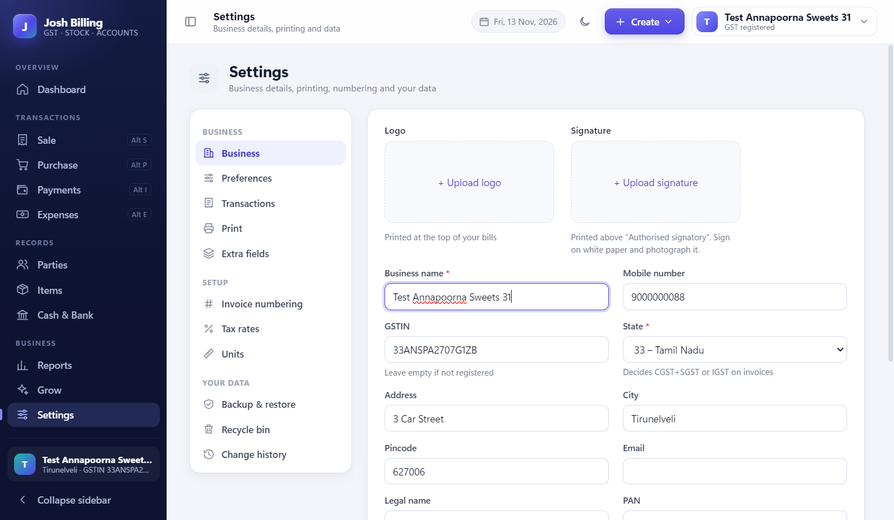

### 2. Preferences
**Settings › Preferences:**

- **GST registered:** on or off.
- **Prices include tax:** **on** for shops that sell at MRP (the customer pays the price on the tag). **Off**
  for wholesalers who quote prices before GST.
- **Paper:** your usual paper for bills. **Thermal 80 mm** or **58 mm** for counter shops, **A4** for
  wholesale. You can still print any bill on another paper; see [Bill or invoice](#bill-or-invoice-print-as).
- **Round off:** rounds totals to the rupee.
- **Allow negative stock:** off, so you never bill what you don't have.

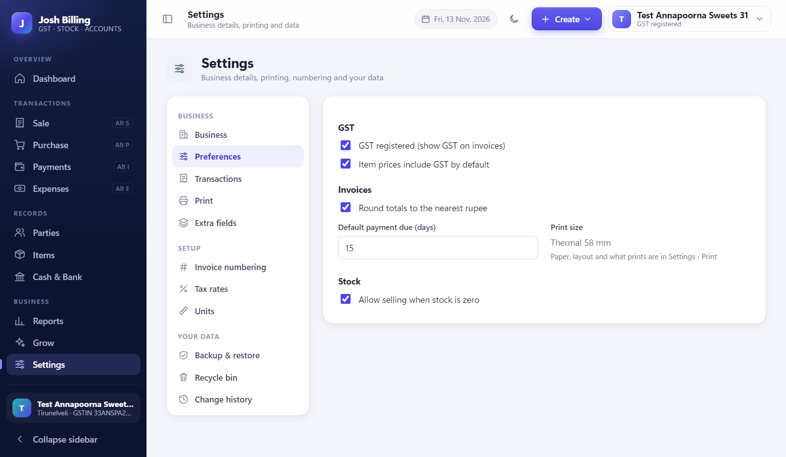

### 3. How bills look
**Settings › Print:** layout (Classic, Boxed, Modern, Compact), colour, text size, and what to show:
logo, HSN, tax summary, amount in words, bank details and **UPI QR**. Also a **footer** line ("Thank you,
visit again", licence numbers) and default terms. The preview on the right updates as you change things.

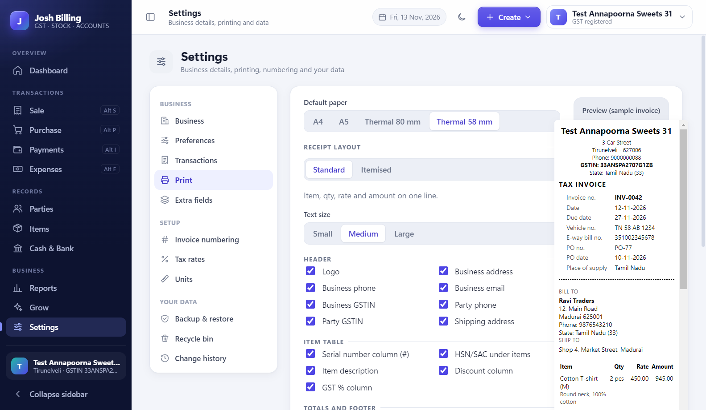

### 4. Your own item fields (size, colour, design no.)
**Settings › Extra fields › Item fields:** switch on up to four fields of your own and name them. A clothing
shop uses *Size*, *Colour*, *Fabric*; a gold covering shop uses *Design no.*, *Finish*. Each item then has
these boxes. Tick **Show in print** to print them under the item on bills; they can also go on labels.

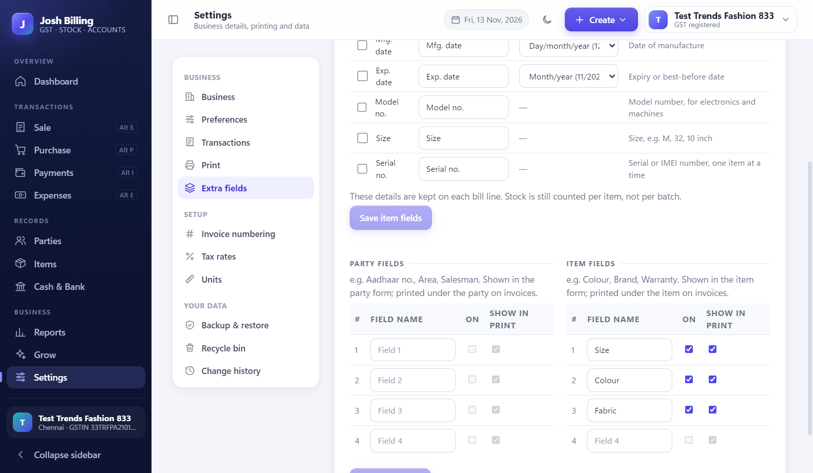

### 5. Units and tax rates
**Settings › Units:** add any unit you need (`strip`, `coil`, `ct`). **Settings › Tax rates:** add a rate that
is missing (for example 1.5%). Confirm the GST rate and HSN code of every product with your CA.

---

## Logo and signature on bills and invoices

Your logo and signature print on every bill: the full A4 / A5 invoice and the small counter bill.

### Upload them
**Settings › Business** has a **Logo** box and a **Signature** box at the top. Click a box and pick the
picture (JPG, PNG or WebP, from the computer or copied from your phone). It is saved straight away; there
is no extra Save button for pictures.

| Before | After uploading |
|---|---|
| 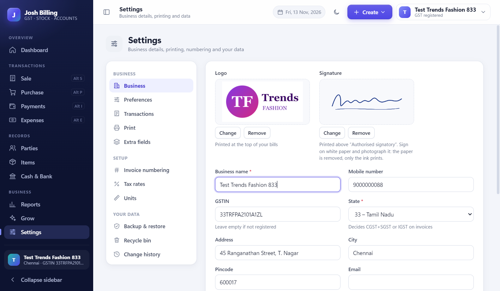 |  |

- **Logo:** a picture of your shop's logo. It is shrunk to fit 600 × 300 pixels, so a big photo is fine. A
  logo with a white or transparent background looks best.
- **Signature:** sign on plain white paper with a dark pen, photograph it (or scan it) and upload it. **The
  app removes the paper**, so only the ink prints: no grey box behind the signature, even on a thermal
  printer. It is shrunk to fit 500 × 160 pixels.
- **Change** puts in a new picture; **Remove** takes it off the bills.
- The pictures are kept inside your business file, so they are in your backups and move with them to a new
  computer.

### Where they print

| Paper | Logo | Signature |
|---|---|---|
| **Invoice A4 / A5** | Top left, beside your business name | Above "Authorised signatory", bottom right |
| **Bill 80 mm / 58 mm** | Centred at the top | Off by default. Switch on **Signature on small (thermal) bills too** |

**Settings › Print** has the switches: **Logo**, **Signature and signatory**, and **Signature on small
(thermal) bills too**. Switch any of them off to leave that part off your prints. Press **Save print
settings** after changing them.

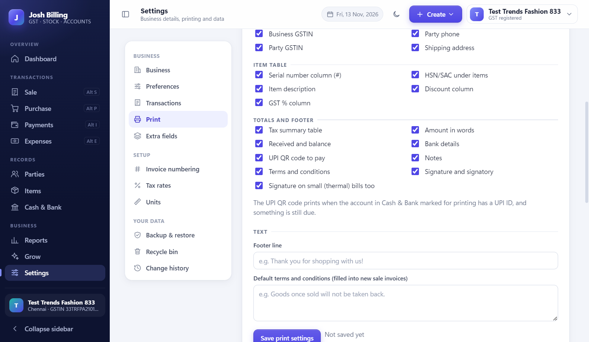

| Invoice A4 with logo and signature | Invoice A5 |
|---|---|
| 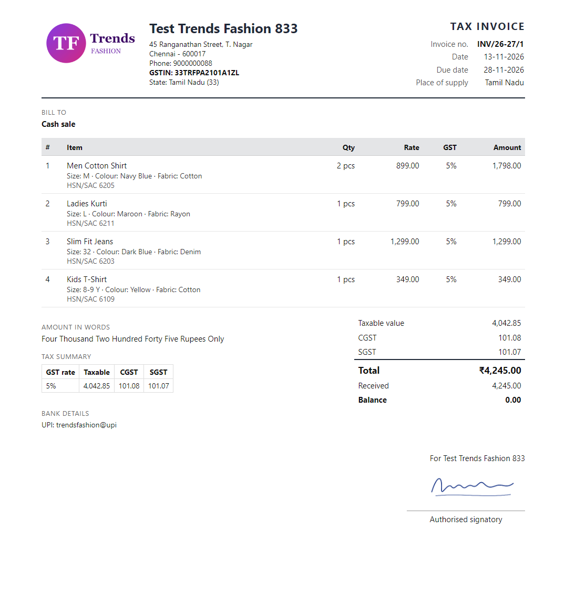 | 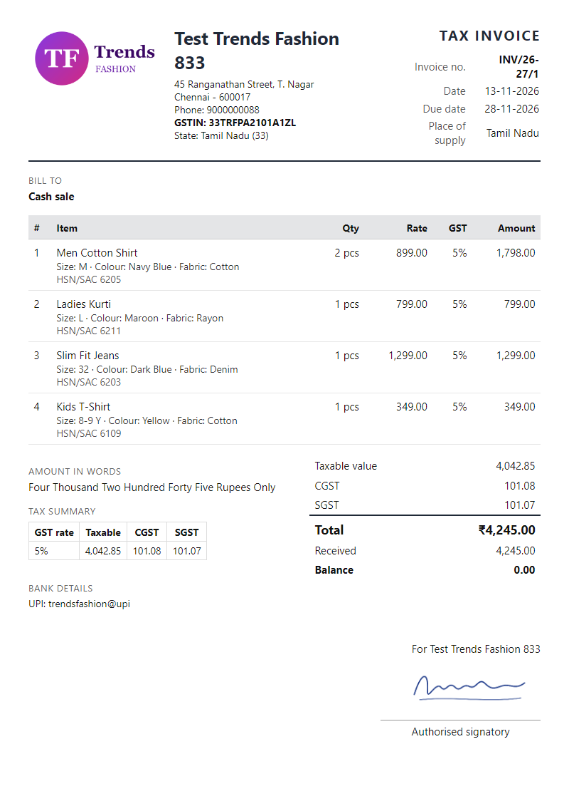 |

| Bill 80 mm (default: logo only) | Bill 80 mm with signature switched on | Bill 58 mm with signature |
|---|---|---|
| 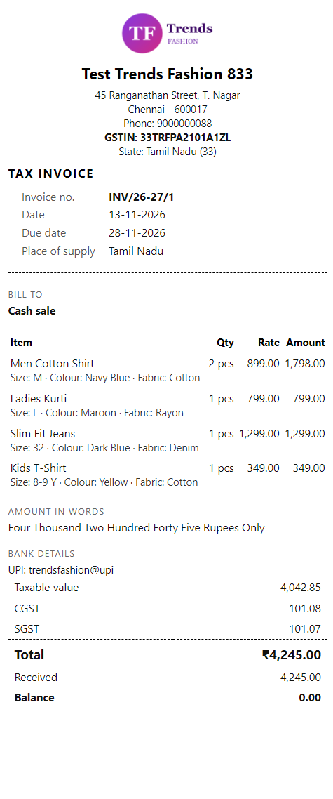 | 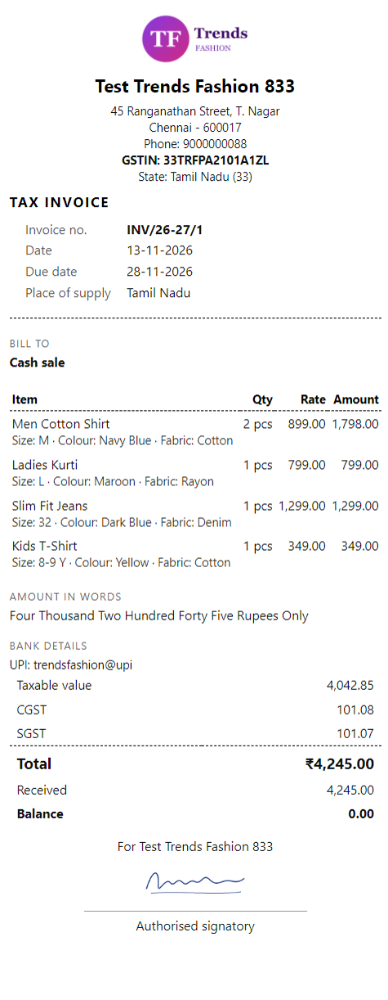 | 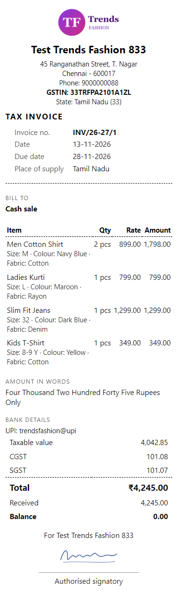 |

Printing, **PDF** and **WhatsApp** (which sends the PDF) all carry the logo and signature.

**Checked** (`scripts/e2e/logo-signature.mjs`, 21 of 21 passed). Using the real Upload boxes, the script:

- Uploaded a 1200 × 600 PNG logo and a 1600 × 600 signature photo. The photo was a JPEG with no file type,
  as some phones send it.
- Checked both were shrunk (600 × 300 and 427 × 160) and kept small (46 KB and 16 KB).
- Checked the signature paper was removed: 96% of the picture is transparent and the ink stays solid.
- Tried **Remove** and uploading again.
- Checked both print on the A4 and A5 invoice. On the 80 mm bill the signature is off by default; with the
  switch on, both print on the 80 mm and 58 mm bills.
- Saved PDFs of both.

---

## Items and barcodes

**Items › Add item** (or Create › Item). For each item enter its name, HSN, unit, GST rate, sale price, MRP
and purchase price. The **wholesale price** and **minimum quantity** are optional. Fill in your own fields
(size, colour…) and the opening stock.

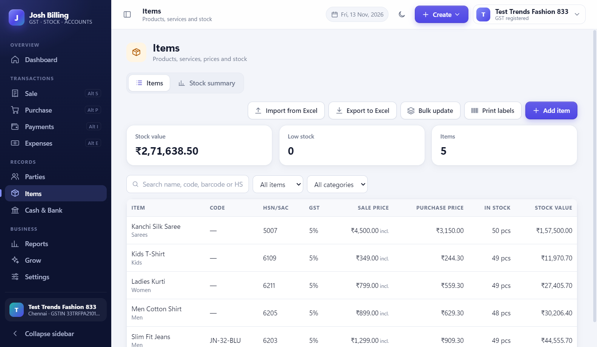

**Barcode:**

- **Product already has a barcode** (packed goods): click in the **Barcode** box and scan the pack.
- **No barcode** (garments, loose goods, your own packets, jewellery): press **Create**. The app gives the
  item an in-store EAN-13 barcode starting with `2`. It never clashes with company barcodes, and every
  scanner reads it.
- **Item code instead:** you can also give an item a short **Item code / SKU** (like `JN-32-BLU`) and skip
  the barcode. Print it as a **QR code** and a 2D scanner reads it.

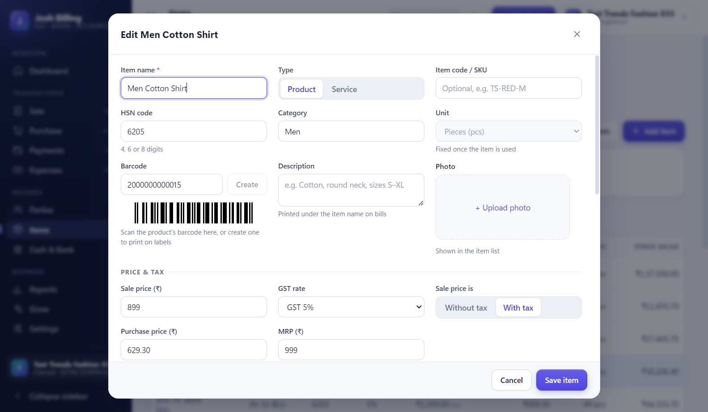

Many items without barcodes? The labels window has a **Create barcodes** button that does them all at once.

---

## Printing labels

**Items › Print labels** opens the labels window.

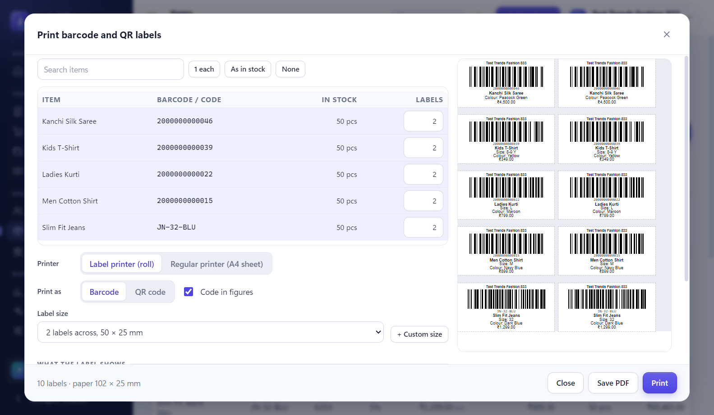

1. **Choose items and how many labels.** Type the count for each item, or press **1 each** or **As in stock**
   (one label for every piece in stock).
2. **Printer:** **Label printer (roll)** or **Regular printer (A4 sheet)**.
3. **Print as:** **Barcode** (any scanner) or **QR code** (2D scanners and phones). Tick **Code in figures**
   to print the number under the code.
4. **Label size:** 50 × 25, 38 × 25, 2-across rolls, 100 × 50, A4 sheets of 65 / 40 / 24. Or **+ Custom
   size**: measure one label and the gap, give it a name, and it is kept for next time.
5. **What each line shows:** a header and up to 4 lines. You can pick:
   - Business name, item name, sale price (with GST), MRP, **You save** (MRP − price).
   - Item code, category, HSN, description.
   - **Your own item fields** (Size, Colour, Design no.…).
   - Batch / model / Mfg / Exp dates typed for this print.
   - Your own fixed text.
6. **Print**, or **Save PDF** to print at a shop or on another computer.

Text shrinks to fit the label. On small labels an own field with a long name ("Design no.") prints just its
value ("D-220"), so the value is never cut off. The design you choose is remembered for this business.

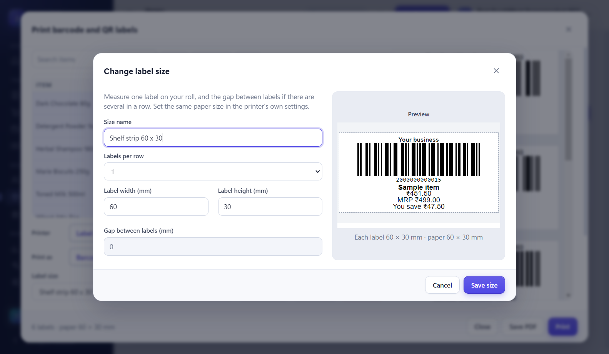

**Printer tip:** set the same paper size in the printer's own settings (for example 50 × 25 mm, or 102 × 25 mm
for a 2-across roll) and print at **100% / actual size**, not "fit to page".

---

## Billing with a scanner

**Sale › New invoice** (Alt+S). Click the box **"Scan barcode or type item code, then Enter"** and scan.

- Each scan adds the item. **Scanning the same item again adds one more** (Men Cotton Shirt × 2).
- A QR label, or an item code typed by hand, works the same way. Capital or small letters both work
  (`ghee200` finds `GHEE200`).
- An unknown code is **not added**; the box shows "No item has the barcode or code …".
- After scanning you can change a line's **quantity** (0.75 for 750 g), its **unit** (pieces ↔ dozens,
  strips ↔ tablets) or its **price**.
- **Wholesale price** applies by itself once the quantity reaches the item's minimum.
- Leave the customer as **Cash sale** for walk-ins (paid in full), or pick a customer for credit and GST bills.

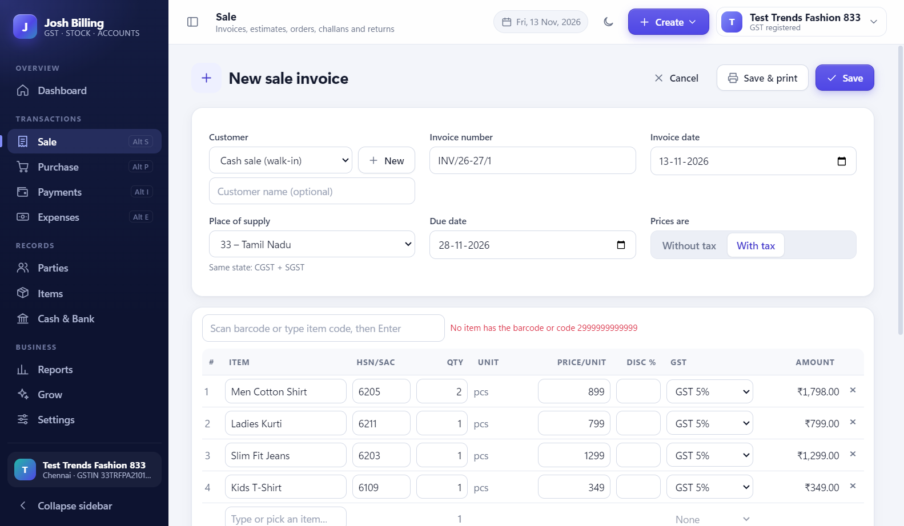

Press **Save** (or **Save & print**).

---

## Bill or invoice: "Print as"

Every saved bill has a **Print as** switch above the preview:

| Choice | For |
|---|---|
| **Bill 80 mm** | Counter receipt on a 3-inch thermal printer |
| **Bill 58 mm** | Counter receipt on a 2-inch thermal printer |
| **Invoice A4** | Full tax invoice on A4 paper: for business customers, GST claims, records |
| **Invoice A5** | Full invoice on half an A4 sheet |

The preview, **Print** and **PDF** all follow the choice, so one sale can be given as a small bill now and
as an A4 GST invoice later. The usual choice comes from Settings › Preferences › Paper.

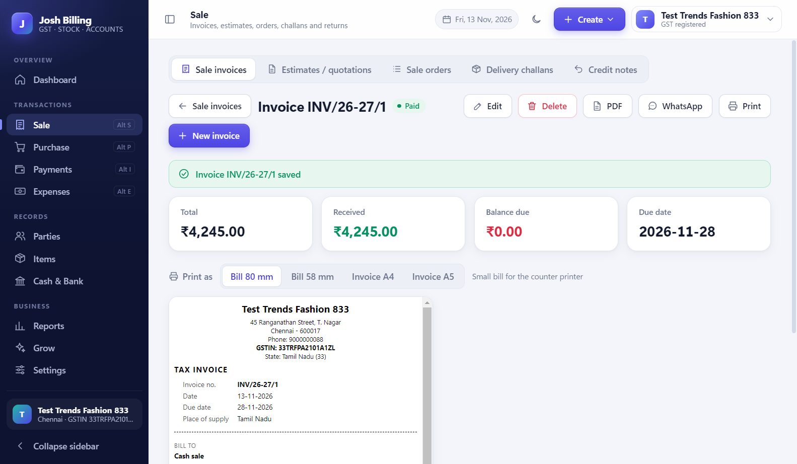

| Counter bill (80 mm) | GST invoice (A4) |
|---|---|
| 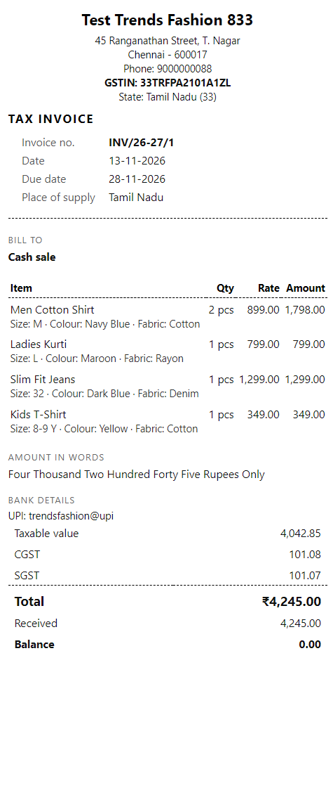 | 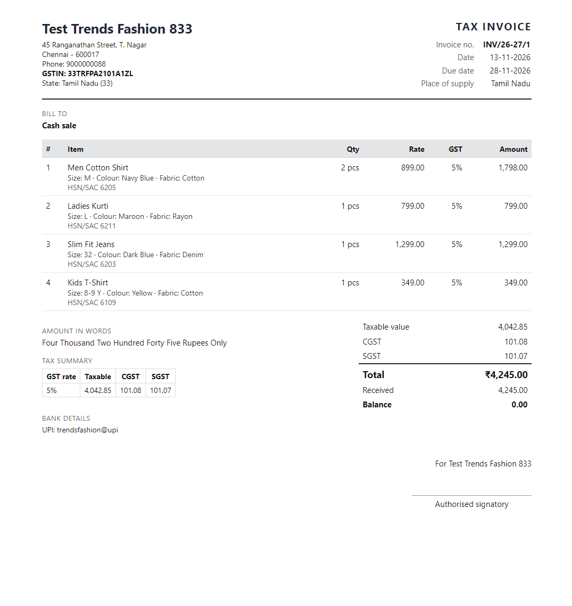 |

When a bill has money due and the business has a UPI ID (Cash & Bank › add a UPI / wallet account with "Print these details on invoices" ticked), the invoice prints
a **"Scan to pay" UPI QR** for the exact amount due. It was checked to hold the right UPI ID, amount and
invoice number.

---

## Shop setups

### 1. Clothing shop (retail)

**Settings:** prices include tax ✔ · paper Thermal 80 mm · own item fields **Size, Colour, Fabric**.

**Items:** one item per style **and size** (each size needs its own barcode, so stock and tags are right):
*Men Cotton Shirt (M, Navy Blue)*, *Ladies Kurti (L, Maroon)*, *Kids T-Shirt (8-9 Y)*, *Kanchi Silk Saree*.
Sale price = tag price, with MRP. Garments are commonly 5% GST up to ₹2,500 a piece, and 18% above that;
confirm with your CA.

**Tags:** label printer, **2 labels across, 50 × 25 mm**, barcode. Header business name; lines
*Item name · Size · Colour · Sale price*.

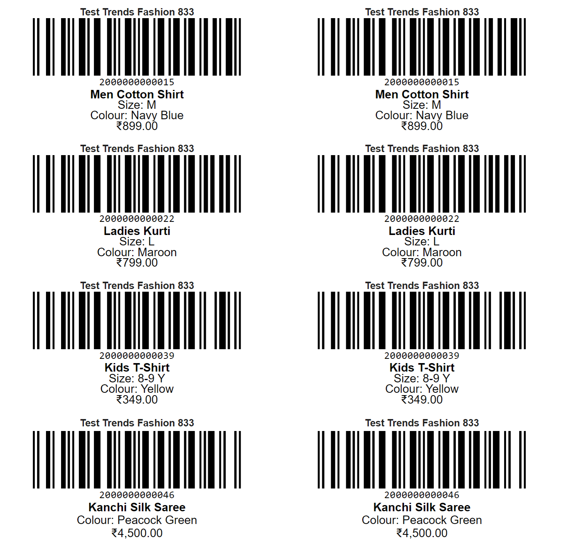

The same tags as **QR codes** (one label across, 50 × 25 mm). The jeans have only an item code
(`JN-32-BLU`), so their QR holds the code:

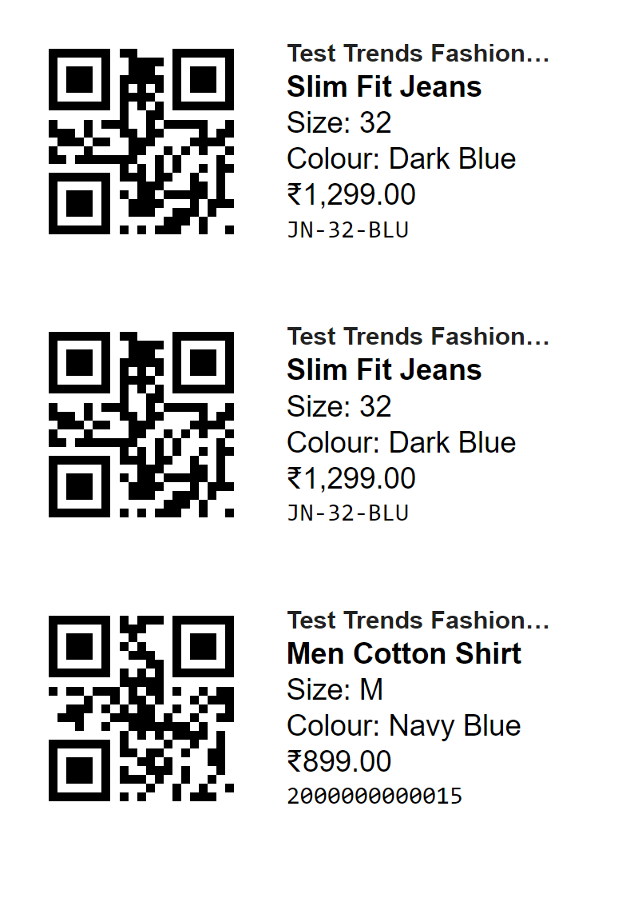

**Billing:** scan tags at the counter. Size, colour and fabric print under each item on both the bill and
the invoice (see the pictures above).

**Checked:**
- 4 barcodes created; every tag (barcode and QR) scanned back.
- Size and colour on the tags.
- 5 scans (one shirt twice, jeans by QR) made 4 lines. Total **₹4,245** at MRP, paid.
- An unknown code was refused.
- Bill and invoice PDFs saved.

### 2. Clothing wholesale

**Settings:** prices include tax ✘ · paper A4 · Transport details on · own item fields *Size range, Colour,
Pack*.

**Items:** base unit `pcs`, second unit `dzn` = 12. **Wholesale price** with a minimum (for example ₹280 a
piece from 120 pieces).

**Carton labels:** regular printer, **A4 sheet of 24 (70 × 37 mm)**; lines *Item name · Size range ·
Pack · Price*.

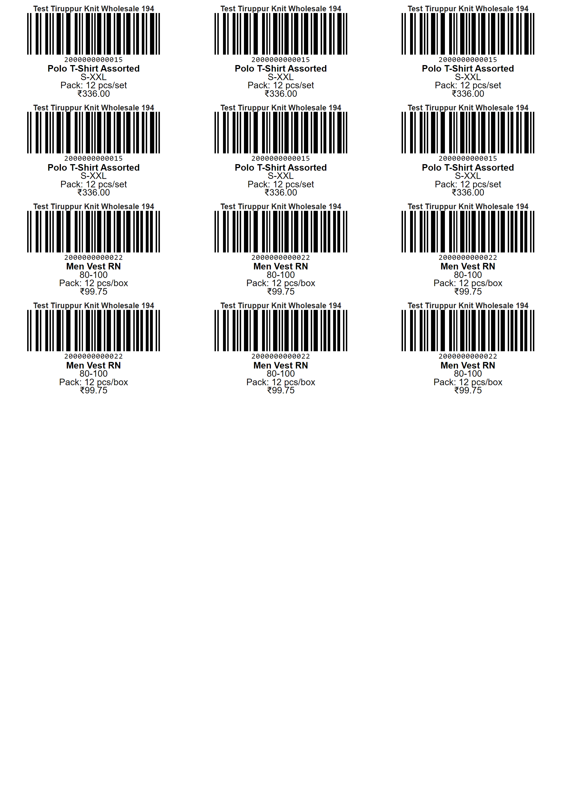

**Billing:** pick the customer (their GSTIN fills the state). Scan each style once, change the unit to `dzn`
and type the dozens. Fill the transport and e-way bill boxes.

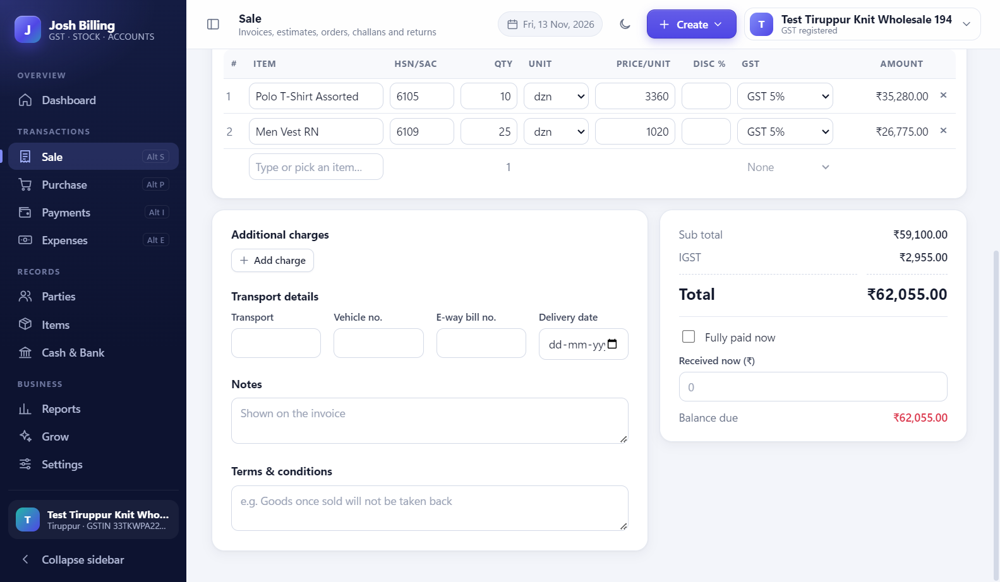

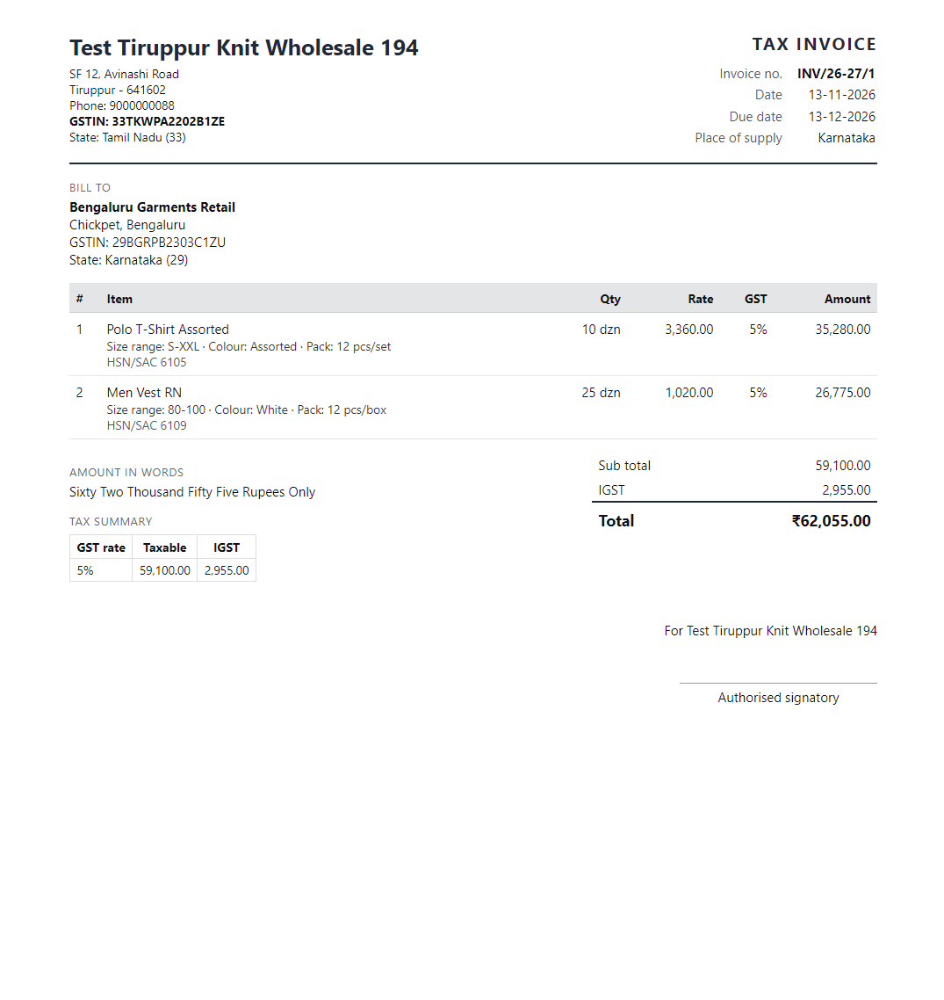

**Checked:**
- Both carton barcodes scanned back.
- Billed as 10 dzn + 25 dzn at the wholesale price (₹3,360 and ₹1,020 a dozen).
- Karnataka buyer → **IGST ₹2,955**.
- Stock fell by 120 pieces.
- Invoice PDF saved.

### 3. Malligai kadai

**Settings:** a small shop that is not GST-registered: GSTIN empty, GST registered off · prices include tax ·
paper **Thermal 58 mm**.

**Items:** packed staples you pack yourself (*Ponni Rice 1kg*, *Toor Dal 500g*, *Sugar 1kg*,
*Tamarind 250g*) with created barcodes. Loose goods (*Groundnut (loose)*, unit `kg`) and others get a short
item code (`GNUT`, `GHEE200`) to type.

**Labels:** regular printer, **A4 sheet of 65 (38 × 21 mm)**: cheap sticker sheets on any printer. Header
none; lines *Item name · Price*.

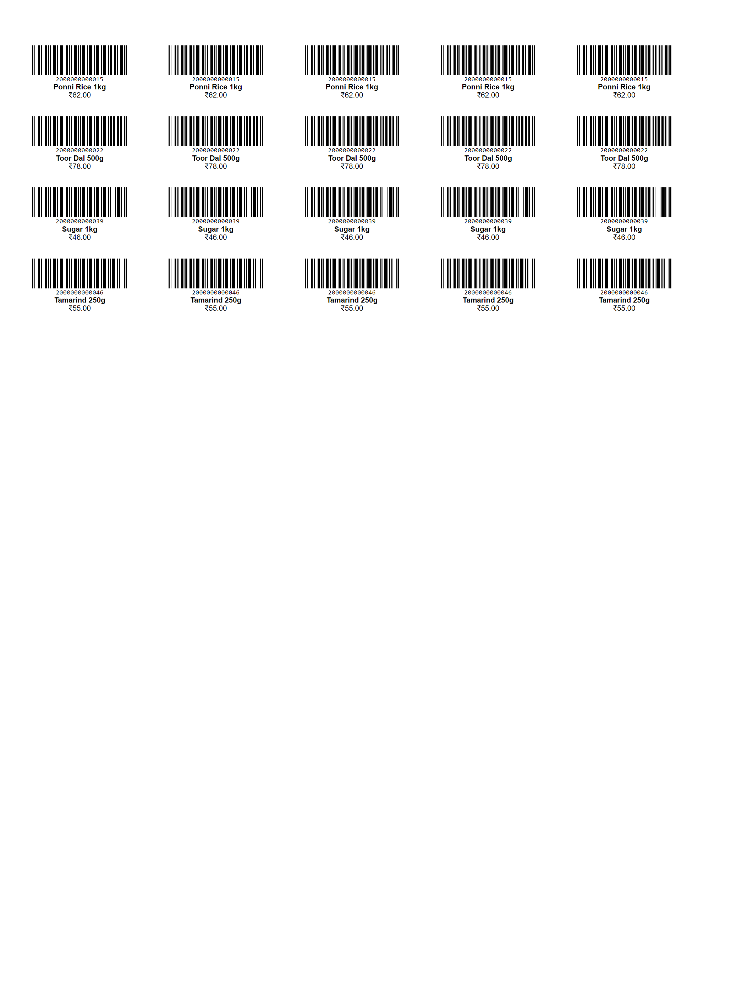

**Billing:** scan packets, type `GNUT` for groundnut and change the quantity to **0.75** (750 g).

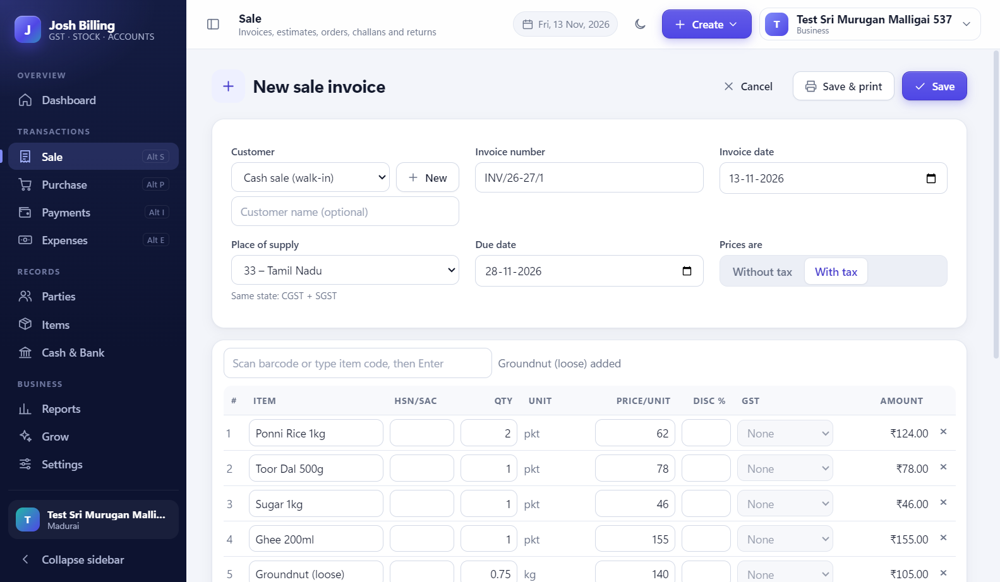

The 58 mm bill is headed "INVOICE" (not "Tax invoice") and carries no GST, as it should for a shop that is
not registered:

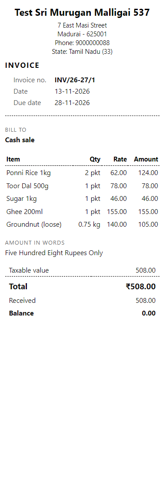

**Checked:**
- All four sticker barcodes scanned back.
- `ghee200` (small letters) found the ghee.
- Total **₹508**, no GST.
- 750 g of groundnut taken from stock.

### 4. Supermarket

**Settings:** GST registered · prices include tax · Thermal 80 mm · a UPI account for the pay QR.

**Items:** packed goods with their **own barcodes** (scan the pack into the Barcode box), MRP and your
lower sale price, each at its own GST rate (milk 0%, biscuits 5%, shampoo 18%).

**Shelf labels:** a **custom size** "Shelf strip 60 × 30". Header business name; lines *Item name · Sale
price · MRP · You save*.

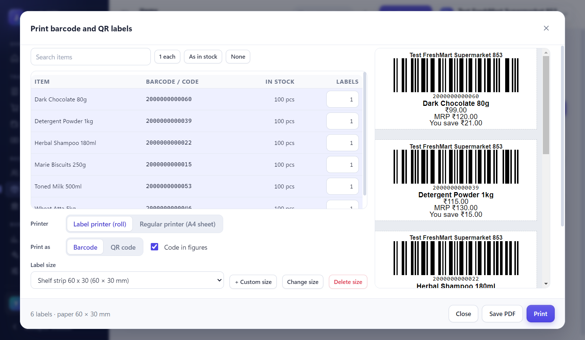

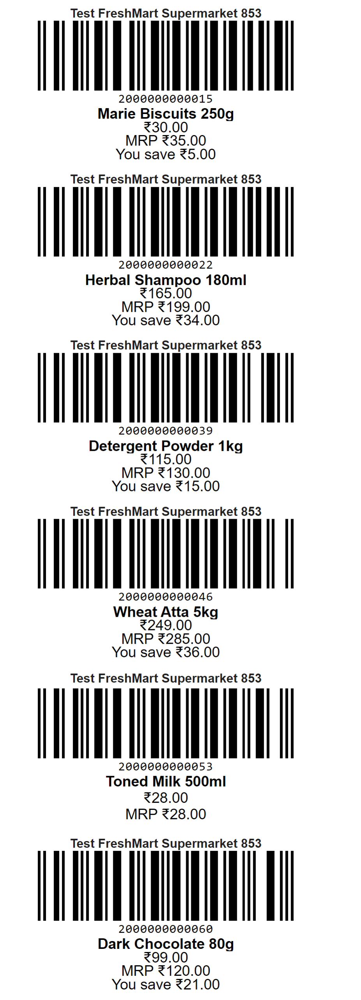

**Billing:** scan everything; repeated scans add up.

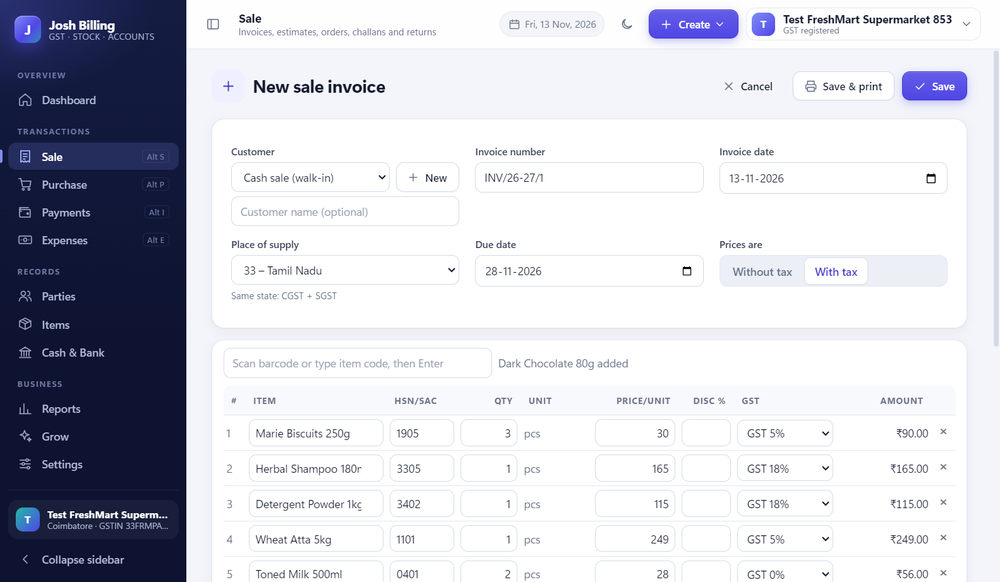

| Counter bill (80 mm) | GST invoice (A4) |
|---|---|
| 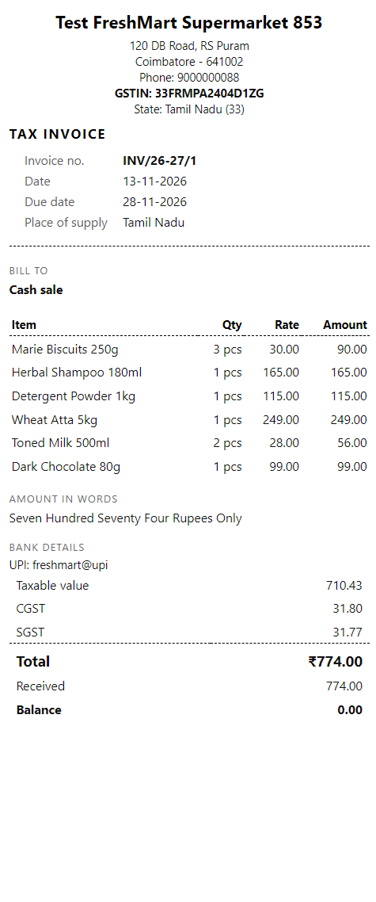 | 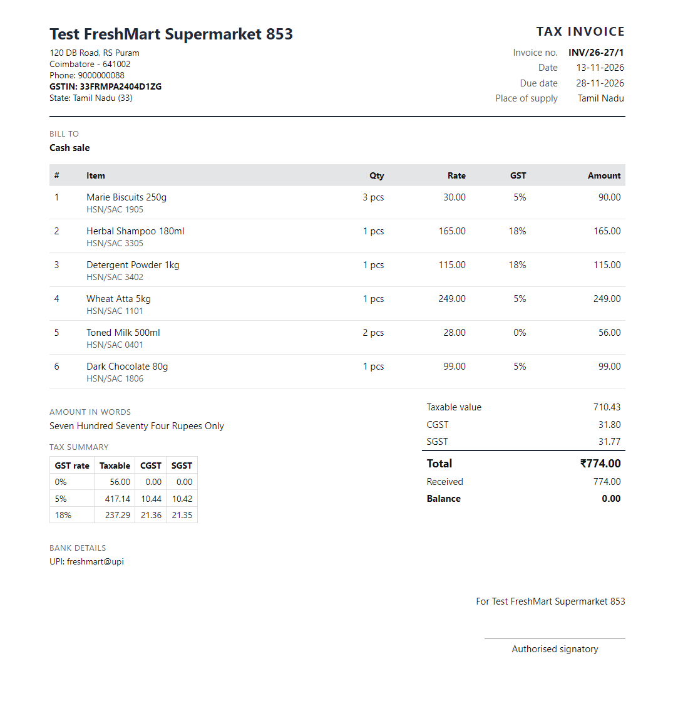 |

**Checked:**
- All 6 shelf barcodes scanned back.
- "MRP ₹199.00 · You save ₹34.00" printed.
- 9 scans became 6 lines, **₹774**, with milk at 0% and the rest at their own rates.
- Bill and invoice PDFs saved.

### 5. Gold covering

**Settings:** GST registered · prices include tax · Thermal 80 mm · own item fields **Design no., Finish**.

**Items:** one item per design, HSN **7117**, GST **3%** (confirm with your CA). Wholesale price for
resellers (₹320 a pair from 12 pairs).

**QR labels:** **2 labels across, 38 × 25 mm**, QR code. Header none; lines *Item name · Design no. ·
Price*. The design number prints on its own (D-101) to fit the small label.

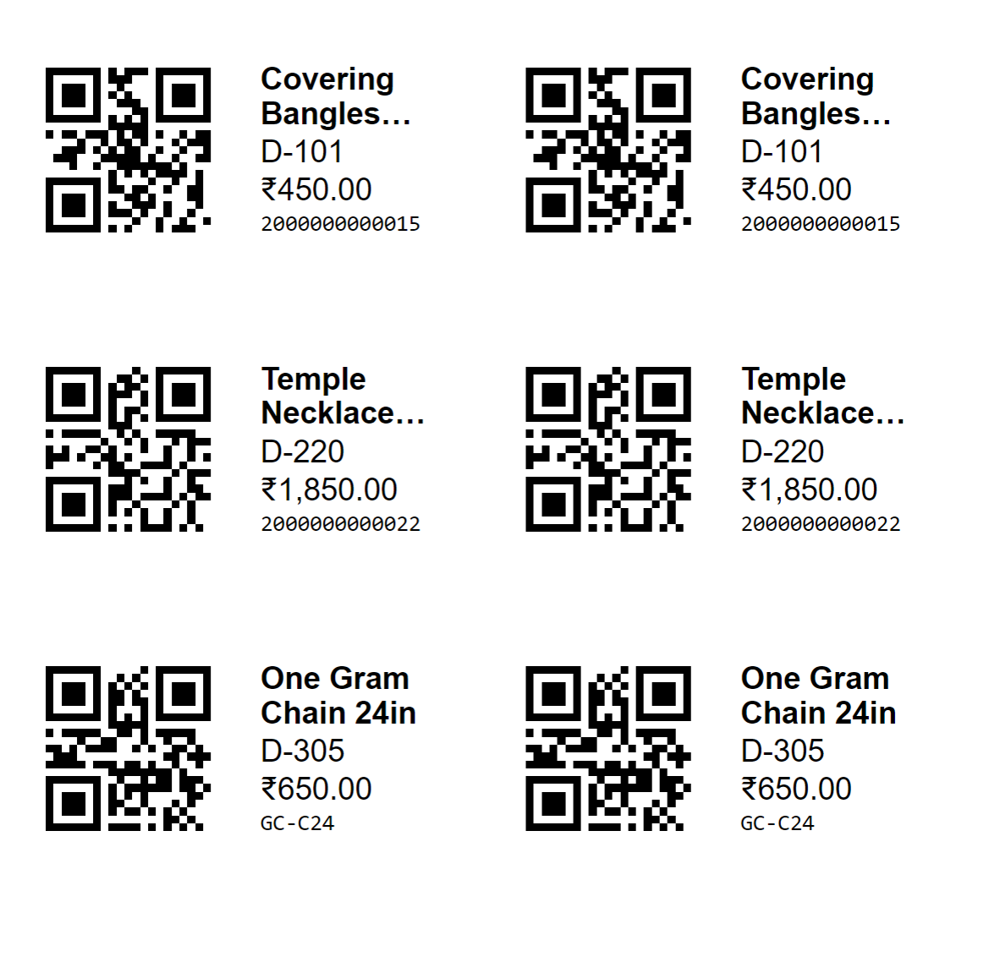

**Counter billing:** scan the QR labels with a 2D scanner.

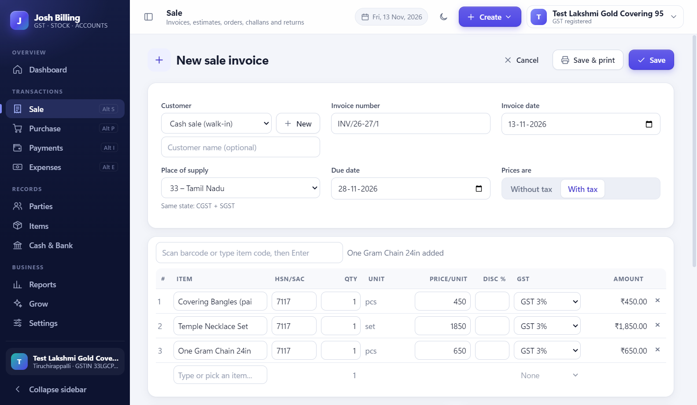

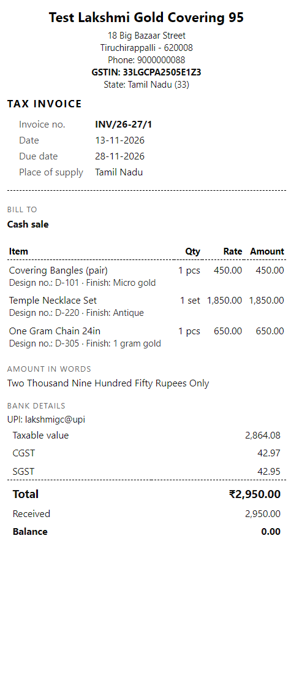

**Checked:**
- All three QR codes scanned back, including the item-code-only chain (`GC-C24`).
- Design number on the label.
- Counter bill **₹2,950** at MRP.
- Bill and invoice PDFs saved.

### 6. GST bill (B2B invoice)

For a business customer who needs your GST bill to claim credit (here, a reseller of gold covering):

1. Add the customer with their **GSTIN** (Parties › Add party). The state fills in from the GSTIN.
2. **Sale › New invoice**, pick the customer, scan the items, type the quantities.
3. Save, then **Print as › Invoice A4**.

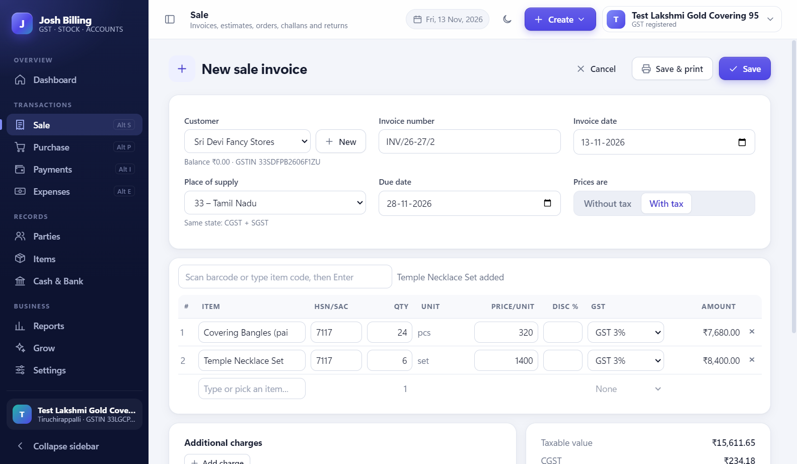

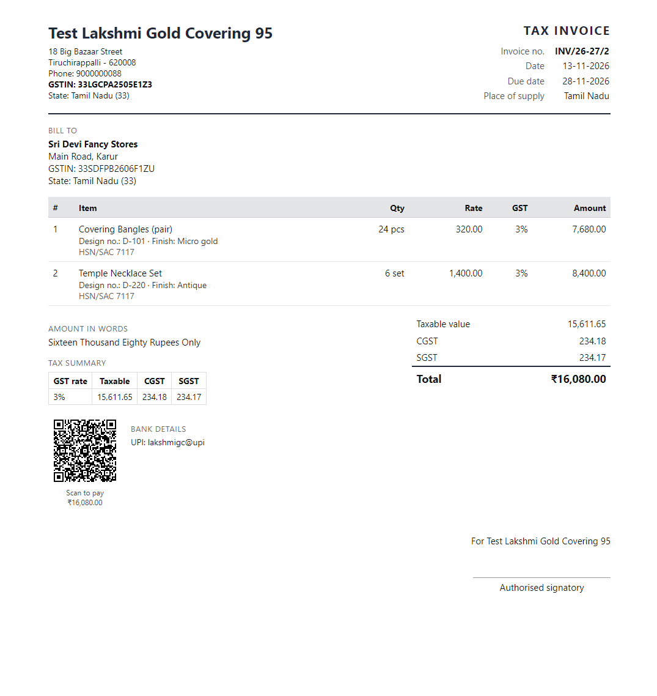

The GST invoice shows:
- Your GSTIN and the buyer's GSTIN, the place of supply and the HSN on each line.
- CGST + SGST (same state) or IGST (another state), and a tax summary by rate.
- The amount in words, and a UPI QR for the amount due.

These bills go into **Reports › GSTR-1** as B2B invoices.

**Checked:**
- The reseller got the wholesale price (24 pairs at ₹320, 6 sets at ₹1,400).
- The bill carries the reseller's GSTIN, CGST ₹234.18 + SGST ₹234.17, and HSN 7117.
- The UPI QR holds `upi://pay?pa=…&am=16080.00&…&tn=Invoice INV/26-27/2`.

### 7. Food and sweets shop

**Settings:** GST registered · prices include tax · Thermal 58 mm.

**Items:** boxed sweets and snack packets with created barcodes (*Tirunelveli Halwa 500g box*, *Kara
Mixture 250g*). Loose sweets sold by weight get an item code (`MPAK`, unit `kg`).

**Packet labels:** 50 × 25 mm; lines *Item name · Price · Mfg date · Exp date*. Type the packing date and
best-before **for each print** in the labels window, so every batch gets its own dates.

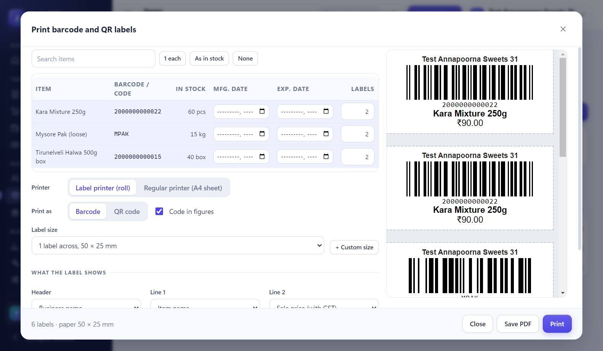

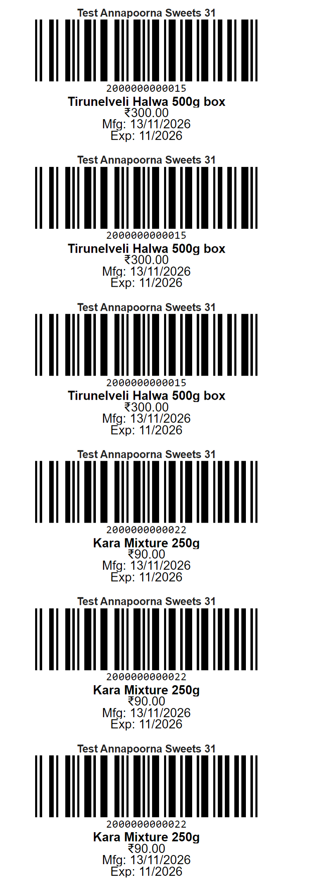

**Billing:** scan boxes and packets; type `MPAK` and change the quantity to 0.25 for 250 g of loose Mysore pak.

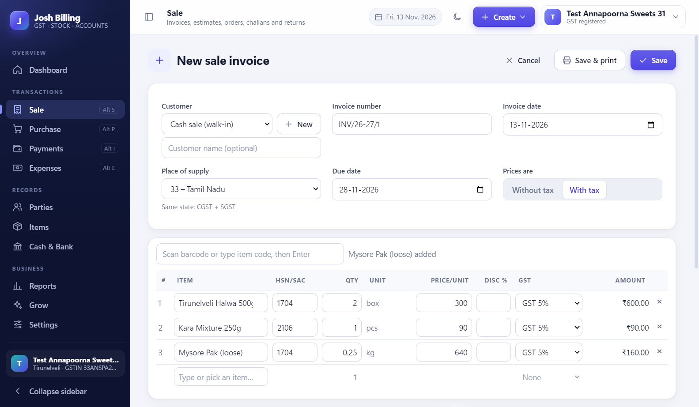

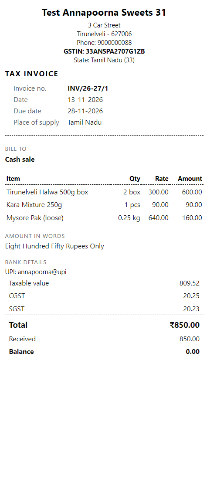

**Checked:**
- Both packet barcodes scanned back.
- Packing date and best-before printed.
- Counter bill **₹850**.
- Bill and invoice PDFs saved.

---

## Troubleshooting

| Problem | Fix |
|---|---|
| Scanning does nothing | Click in the scan box first. Check the scanner sends **Enter** after the code (see its manual's setup barcodes). |
| Wrong characters appear when scanning | Set the scanner's keyboard language to **US English**. |
| QR labels don't scan | A 1D (laser) scanner cannot read QR codes. Use a 2D scanner, or print **Barcode** instead. |
| "No item has the barcode or code …" | The item has no barcode yet, or a different one. Open the item and scan the pack into its Barcode box. |
| Labels print cut off or shifted | Set the printer's paper size to the label size and print at 100%. For rolls with 2 labels across, the paper width is both labels plus the gap. |
| Text on labels is very small | Use fewer lines, or a bigger label size: the app shrinks the text to fit everything you chose. |
| Customer needs a GST bill for a counter sale | Open the bill, choose **Print as › Invoice A4**. To show their GSTIN, the bill must be made out to them as a party (Edit the bill and pick the customer). |
| Signature prints with a grey box | Upload it again: the app now removes the paper. Sign with a dark pen on plain white paper, in good light. |
| No logo or signature on a bill | Check Settings › Print: **Logo** and **Signature and signatory** must be on. On small bills the signature also needs **Signature on small (thermal) bills too**. |
| Bill doesn't show the UPI QR | Add a UPI account in Cash & Bank and tick **Print these details on invoices**; the QR shows only when money is due. |

---

## How this guide was checked

`scripts/e2e/shop-tour.mjs` runs the real app in a separate test profile (never your data). For each shop
above it:

1. Sets up the business, items, own fields and label design.
2. Creates the barcodes.
3. Draws the labels and **reads every barcode and QR code back** with OpenCV (`scripts/e2e/read-codes.py`).
4. Bills by typing each code into the scan box as a scanner does.
5. Checks the lines, totals, GST and stock.
6. Prints each bill as an 80/58 mm bill and as an A4 invoice, saving both PDFs.

The screenshots in this guide come from that run. Result: **69 of 69 checks passed** (13 Nov 2026).

```bash
npm run build
./node_modules/electron/dist/electron.exe . --remote-debugging-port=9333 --inspect=9334 --user-data-dir=e2e-profile
node scripts/e2e/shop-tour.mjs e2e-out
```

See also [docs/business-guides](../business-guides/README.md) for wholesale, retail, medical, electrical,
jewellery and other trades.
